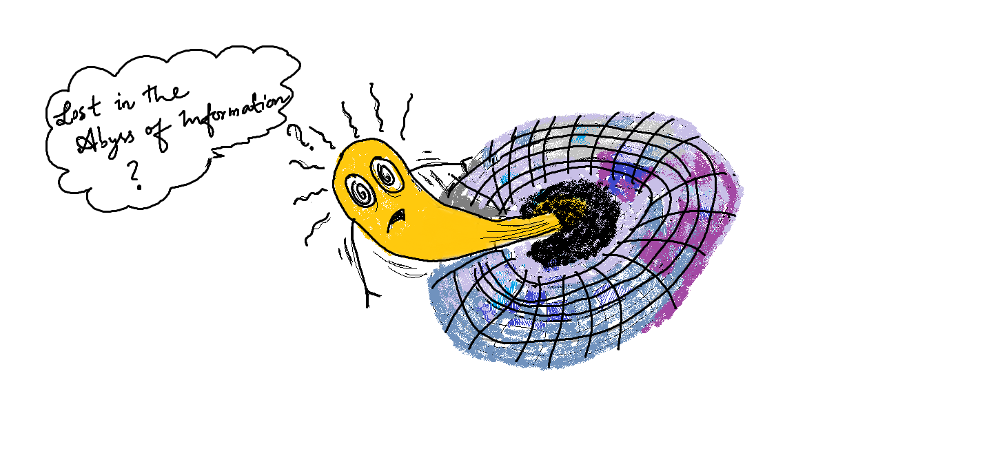
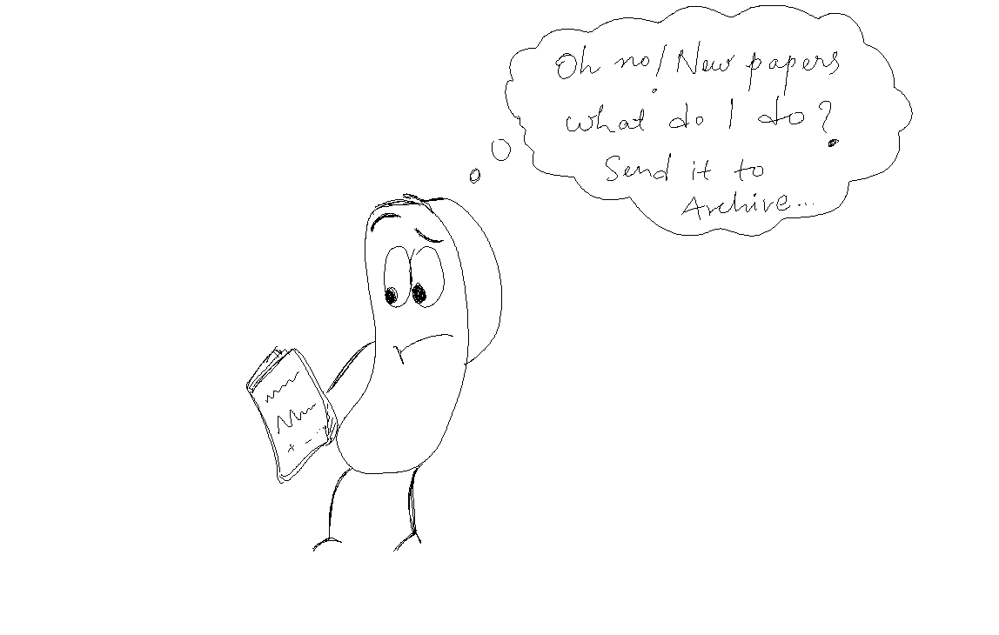
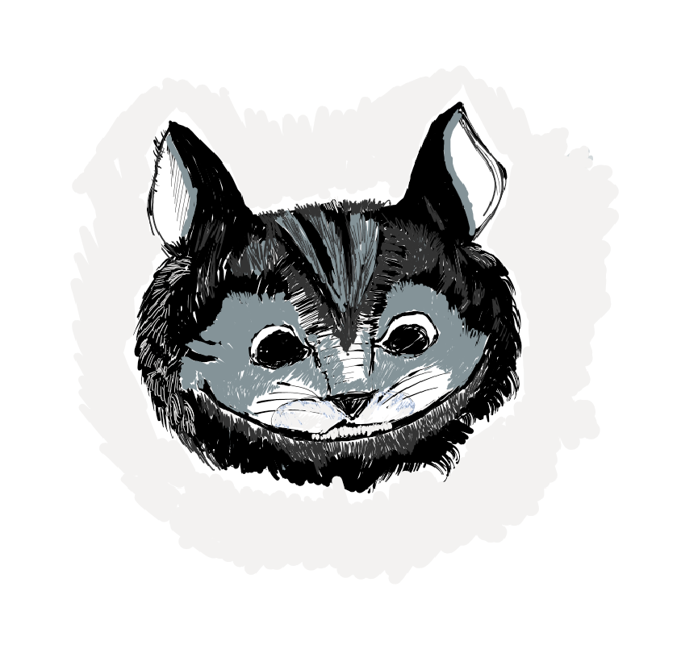
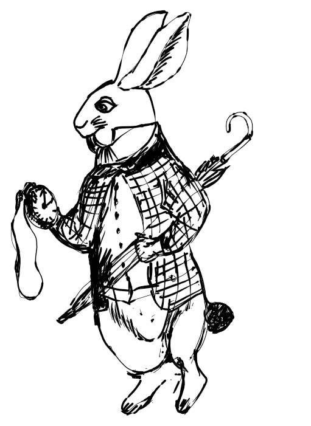

Just posting some doodles and cartoons I made recently, while I getting bored during my work. Finding some place to dump them - Academic life, according to cats, rabbits and all of that.

*Abyss*

*Arxiv to Archive...*

 
<em>Cattidvice — Stare at the paper until it becomes obsolete. This usually takes 5–7 years.</em>

 
<em>Rabbittdvice — Ignore deadlines. True wisdom is timeless—and so are cats and rabbits.</em>

---

© 2025 Anandh Krishna M. All images and captions on this page are original unless noted; please don’t reuse without permission.
